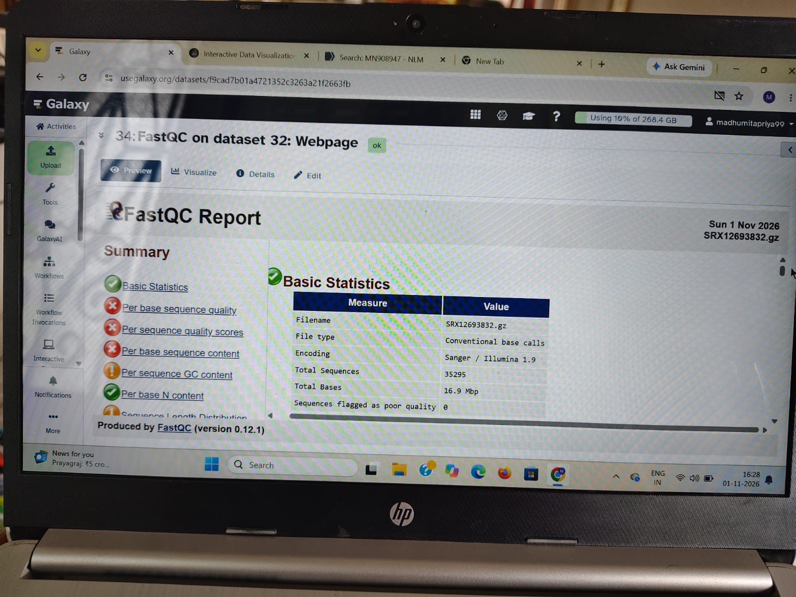
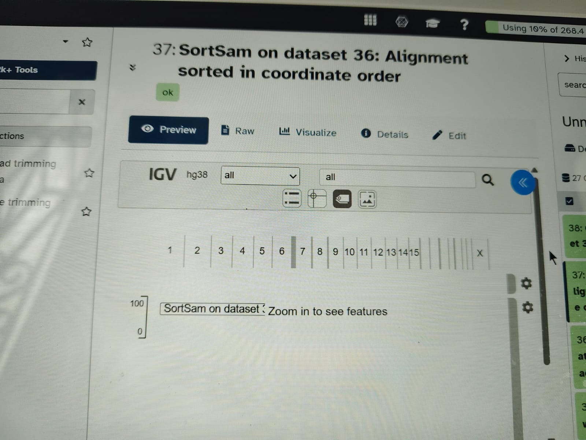
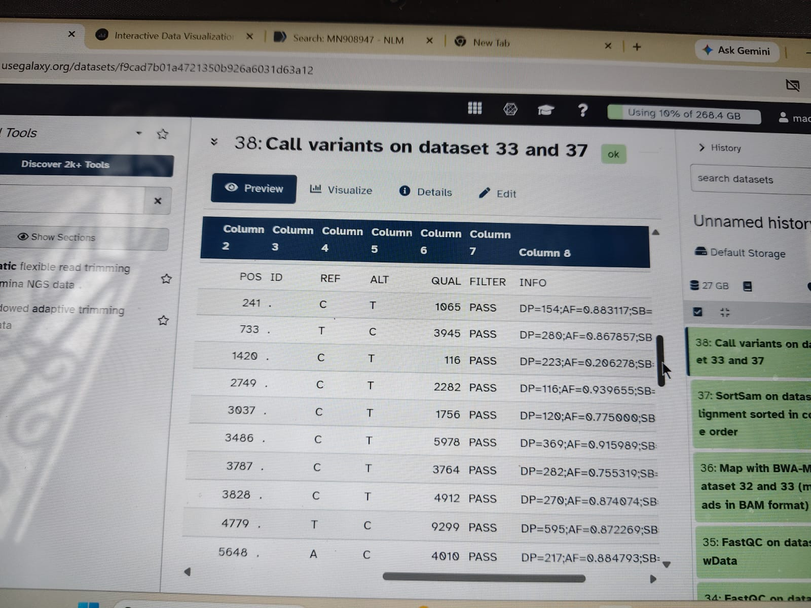

# 🧬 SARS-CoV-2 Variant Calling Pipeline

A complete Galaxy-based bioinformatics pipeline for COVID-19 variant detection using BWA, Samtools & BCFTools.

### 🔬 Tools Used
- **FastQC** - Quality Check
- **BWA-MEM** - Alignment
- **Samtools** - Sorting & Indexing
- **BCFTools** - Variant Calling

### 📋 Workflow Steps
1. Quality Control with FastQC
2. Mapping reads to SARS-CoV-2 reference using BWA-MEM
3. Sorting BAM file with Samtools Sort
4. Variant Calling with BCFTools

### 📸 Pipeline Results

**Galaxy History Panel:**

**FastQC Report:**

**Sorted BAM & VCF Output:**

### 👩‍💻 Developed by
**Madhumitha** - Bioinformatics Student
Project for SARS-CoV-2 Genomic Analysis

---
*Tools: Galaxy | BWA | Samtools | BCFTools | FastQC*
